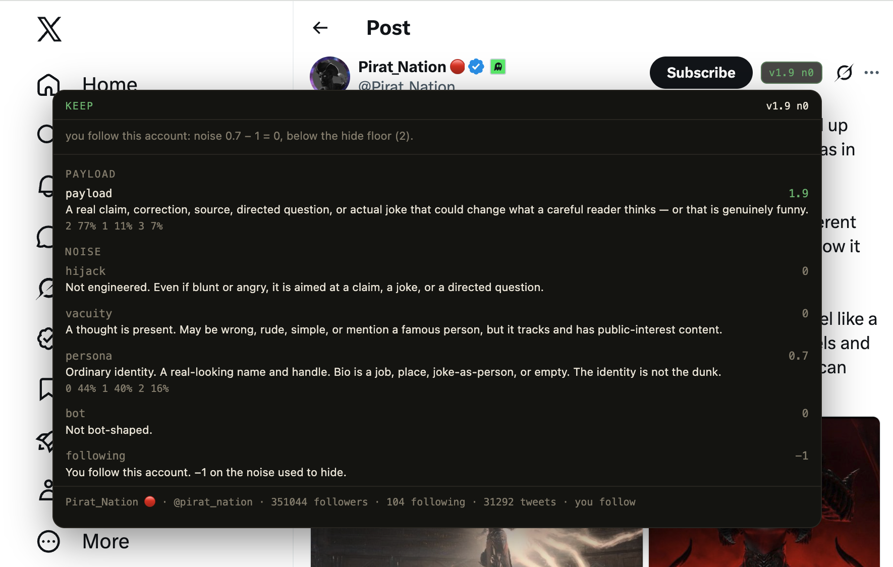

# ForUs

A Chrome extension that hides **noise** on X (Twitter) — engineered packaging and
empty posts — without hiding blunt disagreement.

Each post is scored 0–3 on four independent Jev scales:

- **Payload:** a real point, directed question, fact, or joke
- **Hijack:** outrage / recruitment / reply-harvest packaging
- **Vacuity:** no thought, slop, or tabloid-empty celebrity chatter
- **Persona:** how costume-like or controversial the account identity (name, handle, bio) is

Keep if `payload ≥ 2`. Hide only if payload is below that **and** `max(hijack, vacuity, persona, bot, region) ≥ 2`.
Accounts you follow get −1 on that noise (local overlay; hijack 3 still hides).
A sharply worded correct rebuttal stays visible. An empty sneer does not.

Every scored post gets a small `v… n…` chip (payload and noise) next to X's Grok
button. Click it for the breakdown: each scale's score, the rubric line it landed
on, Jev's probability spread, and any local adjustments such as following.

<p align="center">
  
</p>

Friendly reply-harvest counts as noise too. An open-ended "what's your greatest X?"
prompt has no point of its own (payload 0) and exists to farm comments (hijack 2),
so it hides:

<p align="center">
  
</p>

Named mutes (people or words you never want, even if they cured hunger) stay on **X**.
ForUs additionally sends display name, handle, and bio to Jev for the persona score,
uses follower/following ratio, tweet volume, and join date from the
timeline payload to raise noise on bot-shaped accounts, and shown Community Notes as
scoring context. Pending notes (if you are a contributor) are visible on the score
badge and do not hide a post.

The classifier is a typed decision model, not a chat LLM. Two backends:

- **Jev** (TypeSafe cloud) — paste an API key
- **Laya** ([laya-mlx](https://github.com/mizorewww/laya-mlx), local on Apple Silicon) — same System One contract, ~10ms/question, no key

Not affiliated with X or Twitter. Personal tool, not on the Chrome Web Store.

## Privacy

- The **API key never leaves this device** except as a `Bearer` header to TypeSafe when you use cloud Jev. It is stored in `chrome.storage.local`, not in this repo, and is never injected into the X page.
- Classification sends **post text** plus public account fields already on the tweet (name, handle, bio, follow counts) to Jev or to a **local** Laya server at `127.0.0.1`.
- The page hook only reads GraphQL **your browser already loaded** for the timeline. No extra profile or following-list requests. The one exception is opt-in: **Look up “Account based in”** sends one throttled, cached About-this-account request to X per new author, as your logged-in account. It is off by default and does nothing until you list at least one region.

## Install (unpacked)

1. Clone this repo.
2. Open `chrome://extensions`, enable **Developer mode**, click **Load unpacked**, select this folder.
3. Open the toolbar popup. Either paste a TypeSafe API key, **or** pick **Laya (local MLX)** after starting the local server (below). Click **Test**.
4. Visit [x.com](https://x.com) and scroll.

Hidden posts collapse to the author's identity plus **Show post**.

While you tune, a **ForUs** activity panel in the bottom-right logs each verdict
with its scores and whether it came from the model or the cache. Click a row to
jump to that post. Turn the panel off in the popup once you trust the filter.

<p align="center">
  
</p>

## Config

| Control | Default | Meaning |
|---------|---------|---------|
| Keep if payload ≥ | 2 | Contribution: a real point, question, or joke |
| Hide if noise ≥ | 2 | Highest of hijack / vacuity / persona / bot-shaped / region |
| Account signals | on | Jev scores name/handle/bio for persona; local follows≈followers firehose; never overrides payload |
| Lenient on accounts I follow | on | Timeline already says whether you follow the author; −1 noise for hide; no following-list fetch |
| Regions to filter | empty | Region noise: X’s “Account based in” match = 3, self-typed profile location match = 2; a real point still keeps |
| Look up “Account based in” | off | One extra request per new author (≤ 120/hour, cached 30 days, pauses on rate limit). Off = only when X loads it itself |
| Community Notes | on | Shown note text is classifier context; pending notes are badge-only |

Your API key (cloud only) is stored in `chrome.storage.local` on this device. It never goes into the page.

## Local Laya (Apple Silicon)

Same rubric, same keep/hide line, no cloud round-trip. Needs macOS 14+ and Python 3.11+.

```bash
pip install laya-mlx
python scripts/laya_server.py
```

First run downloads `aac6fef/laya-mlx`. Then in the popup: **Backend → Laya (local MLX)** → **Test**. Default endpoint is `http://127.0.0.1:8765/v1/systemone`.

English Laya is a 512-token model, so local calls score one post at a time. Still far faster than the cloud API.

## Develop

No build step. Edit, hit **reload** on the extension card, refresh x.com. The rubric
lives in `lib/rubric.js` — that's the file you'll change most. See `AGENTS.md` for
architecture notes.

## License

MIT. See [LICENSE](LICENSE).
